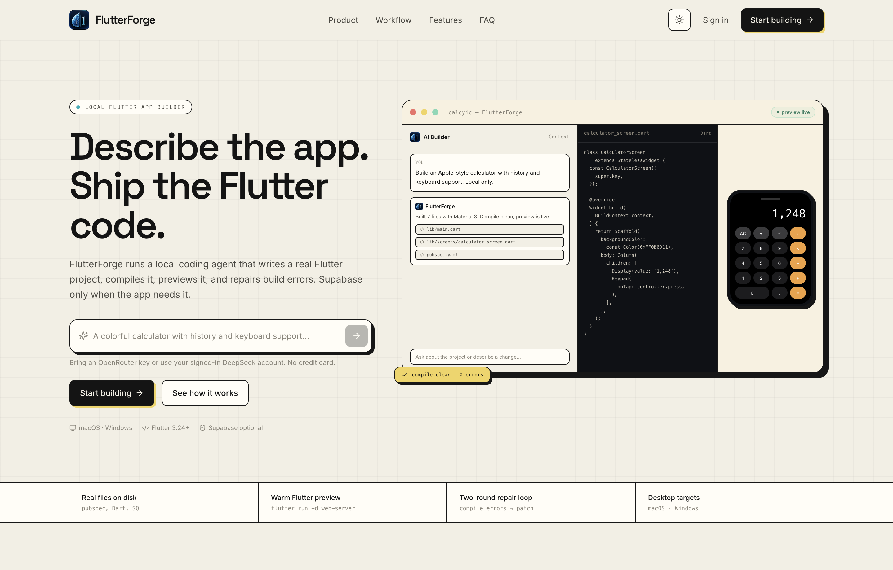

# FlutterForge — Lovable for Flutter, on DeepSeek Harness

> **Describe your Flutter app → the harness writes a complete, runnable project → preview it, then ship it to the web and to macOS/Windows.**



FlutterForge is an AI Flutter app builder. The React workspace talks to a local
**DeepSeek Harness engine** (`dsh headless --json`) that writes real files into a
workspace, validates the result, and streams progress back over SSE. The same UI
runs in a browser or as a signed-ready **Electron desktop app for macOS and
Windows**.

There is **no Python service** in this repository anymore. The old
FastAPI/LangGraph backend was removed; the engine is a Node bridge around the
installed DeepSeek Harness runtime, and the in-browser TypeScript agent remains
as an offline/fallback path.

---

## Architecture

```
Electron shell (macOS .dmg / Windows .exe)
  ├─ BrowserWindow (React + Vite + Monaco + Zustand)
  │     └─ POST /api/harness/stream  (SSE)
  └─ spawns ──► server/index.mjs  (Node, 127.0.0.1:<random port>)
                    ├─ static dist/ (production)
                    └─ harness bridge
                          ├─ workspace: ~/.flutterforge/workspaces/<project>
                          ├─ profile:  ~/.dsh/profiles/flutterforge-engine
                          └─ spawns `dsh --profile … --json --session-id … -`
                                └─ dsh runtime (installed DeepSeek Harness)
                                      ├─ OpenRouter route (llm-pi-ai)   ← app key
                                      └─ DeepSeek official route        ← signed-in account
```

**Generation fallback chain** (never leaves the user with zero files):

1. **DeepSeek Harness engine** — local, streaming, real tool use, persistent sessions.
2. **Signed-in DeepSeek account** — the harness engine retries with `deepseek-account` when OpenRouter keys are exhausted (independent quota).
3. **Supabase edge function** `ai-generate` — hosted fallback (optional).
4. **In-browser TypeScript agent** — `src/agent` (planner, generator, validator, RAG).
5. **Deterministic template generator** — offline, always available.

### Why the engine is a separate process

The browser cannot spawn `dsh`, and a packaged Electron app should not expose the
harness directly to the renderer. The Node bridge owns the workspace, the profile,
the child process, API keys (never persisted), and the SSE projection. Electron
starts it automatically; browser development runs `npm run server`.

---

## Monorepo layout

```
flutterforge/
├── server/                       # Node harness bridge (no Python)
│   ├── index.mjs                 # HTTP + SSE + static UI server
│   ├── harness/
│   │   ├── dsh.mjs               # runtime discovery, profile provisioning, spawn
│   │   ├── run.mjs               # workspace lifecycle + generation turn
│   │   ├── events.mjs            # dsh NDJSON → UI SSE projection + validation
│   │   ├── workspace.mjs         # safe paths, snapshots, diffs, code-block recovery
│   │   ├── flutter.mjs           # Flutter SDK discovery for GUI-launched apps
│   │   └── prompt.mjs            # AGENTS.md + generation prompt contract
│   ├── preview.mjs               # warm `flutter run` preview + build fallback
│   └── test/                     # node:test unit + integration tests (fixture dsh)
├── src/
│   ├── agent/                    # in-browser fallback agent + harnessClient.ts
│   ├── features/                 # landing, auth, dashboard, workspace panels
│   ├── stores/                   # Zustand (project, preview, terminal, …)
│   └── utils/                    # templates, export ZIP, app ids
├── electron/
│   ├── main.cjs                  # window, menu, engine lifecycle, IPC
│   └── preload.cjs               # contextBridge: no nodeIntegration
├── scripts/dev-desktop.mjs       # Vite + Electron in one command
├── preview-infra/server/         # optional Docker/Redis preview farm
├── supabase/                     # migrations + ai-generate edge function
├── Dockerfile                    # web UI + harness bridge (engine optional)
└── docker-compose.yml
```

---

## Quick start

### Prerequisites

- **Node.js 20+**
- **DeepSeek Harness** installed (or set `DSH_BIN` to its `dsh` CLI)
- An **OpenRouter key pool** (`sk-or-…`, free models work) **or** a signed-in DeepSeek
  Harness account (the engine falls back automatically)
- **Flutter 3.24+ / Dart 3.4+** for the live preview
- Optional: Supabase project for auth/projects persistence

### 1. Install

```bash
npm install
cp .env.local.example .env.local
# set VITE_SUPABASE_URL, VITE_SUPABASE_ANON_KEY, VITE_OPENROUTER_API_KEY
```

### 2. Web development

```bash
# terminal A — harness engine
npm run server        # http://127.0.0.1:8787

# terminal B — UI
npm run dev           # http://localhost:5173 (proxies /api to :8787)
```

### 3. Desktop development (one command)

```bash
npm run dev:desktop
```

This starts Vite, then Electron. Electron starts the harness bridge itself (or
reuses one already running on `:8787`).

### 4. Docker (web UI, optional)

```bash
docker compose up --build     # http://localhost:8787
```

The image contains the UI, the harness bridge, and the preview compiler. The
DeepSeek Harness runtime and the Flutter SDK are **not** in the image: mount a
Linux DSH runtime and set `DSH_BIN`, and extend the image with Flutter if you
need live previews. Without them the UI still loads and the browser agent
fallback works.

### 5. Build installers

```bash
npm run dist:mac      # .dmg + .zip, arm64 + x64 (build on macOS)
npm run dist:win      # .exe (NSIS), x64 (build on Windows or with Wine)
npm run build:desktop # unpacked app for local smoke testing
```

Artifacts land in `release/`. Neither target is code-signed yet: expect
Gatekeeper/SmartScreen warnings until you add an Apple Developer ID and a
Windows signing certificate.

---

## The harness engine

### Profile

The bridge provisions a dedicated profile at
`~/.dsh/profiles/flutterforge-engine` the first time it runs. It is based on the
`headless` bundle and adds:

- the **OpenRouter** route through the bundled `llm-pi-ai` adapter
  (`OPENROUTER_API_KEY`, `https://openrouter.ai/api/v1`);
- the **DeepSeek official** route (`DEEPSEEK_API_KEY` / managed sign-in);
- `agent-default-model` selected per request from the browser.

Override with `FLUTTERFORGE_DSH_PROFILE` if you want a different profile name.
The profile is separate from any `flutterforge` UI profile you may already have.

### Workspaces and sessions

Each project owns `~/.flutterforge/workspaces/<project-id>`. Initial generation
resets it; edit turns reuse it. The `dsh` session id is persisted in
`.flutterforge/session.json`, so follow-up prompts continue the same conversation
and the agent sees its earlier work. `DELETE /api/harness/session/:id` resets both.

### API

| Method | Endpoint | Description |
|---|---|---|
| `GET` | `/health` | Engine + runtime health |
| `GET` | `/api/harness/capabilities` | Runtime, profile, route, Flutter, desktop targets |
| `POST` | `/api/harness/stream` | **Primary** — SSE generation |
| `GET` | `/api/harness/session/:projectId` | Read the current workspace snapshot |
| `DELETE` | `/api/harness/session/:projectId` | Delete workspace + session |
| `GET` | `/api/harness/workspace?project_id=…` | Workspace path |
| `POST` | `/api/preview/:projectId/build` | Start the warm Flutter web preview |
| `GET` | `/api/preview/project/:projectId/status` | Latest preview status + logs |
| `GET` | `/api/preview/:sessionId/status` | Poll one preview build |
| `POST` | `/api/preview/:sessionId/stop` | Stop a preview build |
| `GET` | `/preview/:projectId/*` | Static preview (build mode) / redirect to warm server |
| `POST` | `/api/terminal/run` | Real allow-listed command in the project workspace |

SSE events:

| Event | Payload |
|---|---|
| `agent_event` | `{node, phase, message, stepNumber, totalSteps, thought?, activeFile?}` |
| `token` | `{node, token, phase}` |
| `file_ready` | `{path, content, action, language, node}` |
| `files_merged` | `{count, paths}` |
| `validation` | `{is_valid, summary, issue_count}` |
| `done` | `{success, fileCount, sessionId, workspace, summary}` |
| `error` | `{message, code}` |

### Server environment

| Variable | Default | Meaning |
|---|---|---|
| `PORT` | `8787` | Bridge port (`0` = ephemeral, used by Electron) |
| `HOST` | `127.0.0.1` | Bind address |
| `DSH_BIN` | auto-detect | Path to the `dsh` CLI |
| `DSH_HOME` | `~/.dsh` | Harness profiles, sessions, credentials |
| `FLUTTERFORGE_DSH_PROFILE` | `flutterforge-engine` | Engine profile name |
| `FLUTTERFORGE_WORKSPACES` | `~/.flutterforge/workspaces` | Per-project workspaces |
| `FLUTTERFORGE_HARNESS_TIMEOUT_MS` | `1200000` | Per-turn hard timeout |
| `FLUTTERFORGE_PREVIEW_MODE` | `run` | `run` = warm Flutter web server; `build` = static release build |
| `FLUTTER_BIN` | auto-detect | Flutter SDK executable for preview/terminal |
| `OPENROUTER_API_KEY` / `DEEPSEEK_API_KEY` | — | Fallback keys when the UI does not send one |

`dsh` discovery order: `DSH_BIN` → bundled `resources/dsh/bin/dsh` → installed
DeepSeek Harness app → `dsh` on `PATH`.

---

## Flutter desktop (macOS / Windows)

The project wizard now offers **Desktop (macOS + Windows)**, **macOS only**, and
**Windows only**. The chosen target is passed into the engine prompt so the
generated Dart stays desktop-safe (platform guards, desktop-capable packages).

Flutter does not ship native runner folders for every target in a generated
source tree. The export adds helper scripts:

```bash
bash tool/create_platforms.sh          # macOS + Windows runners
flutter run -d macos                   # or -d windows
flutter build macos --release
flutter build windows --release
```

On Windows PowerShell: `.\tool\create_platforms.ps1`.

The **preview canvas** is the real Flutter **web** build served by the embedded
Node bridge (`server/preview.mjs`). Like FlutterPad, it keeps a warm
`flutter run -d web-server` process per project, so edits reload in seconds
instead of rebuilding a release bundle each time. Set
`FLUTTERFORGE_PREVIEW_MODE=build` for a one-shot `flutter build web` static host
(hosted/Docker deployments). The bridge discovers the Flutter SDK even when the
desktop app was launched from Finder/Explorer (where `PATH` is minimal).
`preview-infra/` remains available as an optional Docker/Redis build farm.
Native macOS/Windows preview requires running `flutter run -d macos|windows` on
that OS; the export README says so rather than pretending a web iframe is a
native window.

---

## Generation quality and speed

- **Fast model first.** The harness starts on
  `nvidia/nemotron-3.5-lightning:free` (~1 minute for a focused app), then retries
  on the larger quality model if the first answer is incomplete.
- **No shell turns in initial generation.** The model writes files directly;
  `flutter analyze`/`pub get` are not run by the agent during the first build.
  The preview compiler validates, and repair turns can still analyze.
- **6–10 file budget.** Small widgets/models are combined so a focused app does
  not turn into a 40-file, multi-minute run.
- **Batched file persistence.** Generated files are upserted in one request
  instead of one Supabase round-trip per file.
- **Warm preview cache.** The preview keeps `.dart_tool`, `pubspec.lock` and
  build output between edits, and skips `flutter pub get` when pubspec is
  unchanged.
- **Dead keys are skipped.** When all pool keys are cooling down or the free
  daily quota is hit, the engine jumps straight to the managed account instead
  of retrying dead keys.
- **Key-pool failover.** Up to three OpenRouter keys are tried; each failure is
  tracked in the pool with a cooldown. When the pool is exhausted, the engine
  retries the signed-in DeepSeek account (`deepseek-account`).
- **Completeness gate.** A fresh run without `pubspec.yaml` or `lib/main.dart`
  is rejected before it reaches the project store.
- **Package identity is pinned.** The requested `app_id` is enforced in
  `pubspec.yaml`, and stale self-imports (`package:<old_id>/…`) are rewritten.
- **New projects start empty.** No demo auth/onboarding/Supabase starter files
  are written. The first prompt creates the real project; old starter files from
  pre-upgrade projects are removed after a successful first generation.
- **Conditional Supabase.** The wizard has `Backend: Auto / Supabase / Local
  only`. Auto adds Supabase only when the prompt asks for accounts, shared data,
  realtime, commerce, chat, etc. A calculator or timer stays local.

## Studio UI and real workspace features

The product surfaces use a light-first **Studio** design system (cream paper,
ink borders, pastel accents, hard offset shadows, Space Grotesk display type).
Dark mode is still available from the theme toggle.

- The **AI Builder tab is a full-page chat**: rich Markdown, code blocks with
  copy buttons, message copy/retry, per-file change lists, and a collapsible
  activity card. Other tabs keep a compact chat sidebar. The old multi-stage
  “Multi-Agent” dashboard is gone.
- A **Context** popover shows exactly what the chat knows: file/screen counts,
  backend mode, active file, dependencies, history size and estimated tokens.
  The chat receives a compact project tree, active-file excerpt, dependencies
  and latest build errors.
- **Native macOS/Windows menus plus a visible in-app menu bar** are wired to real actions: New Project,
  Workspace tabs, New Chat, Retry/Copy last response, Stop, Export, Open Project
  Folder, bottom-panel toggle and shortcuts.
- **Four project skills** are installed per workspace (`modern-flutter-ui`,
  `flutter-architecture`, `desktop-web-parity`, plus `supabase-production` only
  for backend apps) and loaded by the engine on demand.
- **Professional dark studio** palette: charcoal surfaces, low-contrast
  hairlines, warm yellow accent and subtle elevation (no cream borders or neon
  shadows in dark mode).
- The fake “Live Canvas” widget parser and the placeholder Components,
  Connectors, Git and Deploy views were removed.
- The terminal runs **real** allow-listed commands (`flutter analyze`,
  `flutter pub get`, `dart analyze`, `ls`, `pwd`, `cat`, `git status`) inside the
  project workspace via `POST /api/terminal/run`.
- Preview, rebuild, export, versions and settings are the only workspace
  surfaces; every button is wired to a real endpoint or store action.

## Supabase

- `supabase/migrations/` contains the schema, RLS, and vector store.
- `supabase/functions/ai-generate/` is the optional hosted fallback used when the
  local engine is unavailable.
- Set `VITE_SUPABASE_URL` and `VITE_SUPABASE_ANON_KEY`; never ship a service-role
  key to the client.

---

## Tests and checks

```bash
npm run typecheck     # TS
npm run test:server   # node:test (unit + integration with a fixture dsh)
npm run build         # Vite production build
npm run check         # all three
```

The integration test drives the real HTTP/SSE surface with `server/test/fixture-dsh.mjs`,
so it verifies workspace isolation, path traversal rejection, event projection,
session reuse, and reset without spending model tokens.

---

## Known limitations

- **The harness runtime is not bundled.** The desktop app discovers an installed
  DeepSeek Harness (or `DSH_BIN`). Bundling the runtime is a licensing/packaging
  decision, not a code gap.
- **Windows packaging is untested on real Windows hardware** (the code paths are
  written; NSIS builds are happiest on Windows or Wine).
- **No signing/notarization/auto-update** yet.
- **OpenRouter free models share a daily quota.** The key pool rotates up to three
  keys, then retries the signed-in DeepSeek account. If both are exhausted, the
  app says so instead of silently producing a placeholder.
- **One generation per project at a time** (the bridge returns `409`/`ALREADY_RUNNING`).
- **A fresh run must produce `pubspec.yaml` and `lib/main.dart`.** Partial answers
  are rejected and retried with the next key / quality model.
- **Preview is Flutter web**; native desktop preview is a local `flutter run`.
- **Flutter SDK is not bundled**; the bridge auto-detects it from common install
  locations or `FLUTTER_BIN`.
- The academic reports (`THESIS_*.md`, `COMBINED_*.md`, etc.) describe the earlier
  Python/LangGraph architecture and are kept as historical artifacts.

---

## License

Private project. DeepSeek Harness is a separate product; check its license before
redistributing its runtime with this app.
